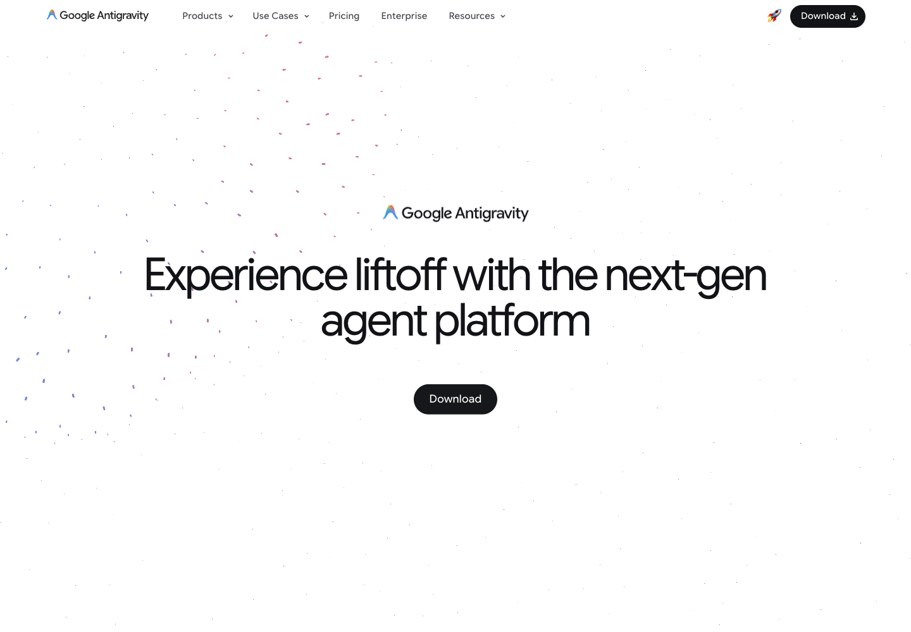
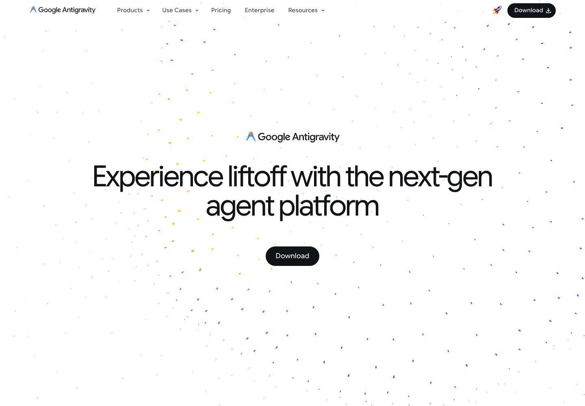

# Antigravity · 疏密粒子与清晰前景

[Source](https://antigravity.google/) · Inspected 2026-10-11 · Browser viewport 1440×1000.

Evidence: Original site; initial and time-separated pointer-position captures.

## Observed craft

- Small multicolor marks create a sparse field around black typography on white.
- The primary action and title remain much more visually definite than the field.
- The distribution changes over time; the browser contains a viewport-size canvas.

## Transfer

Design density, flow direction and content protection as one composition. A small ambient field can give an app identity without extra copy.

## Avoid

Do not sprinkle uniform confetti over chart marks or replicate a giant marketing hero in a compact workspace.

## Motion evidence

Time-separated pointer captures changed, but pointer causality, forces and implementation were not isolated. Specify and verify the chosen response in a real prototype.
