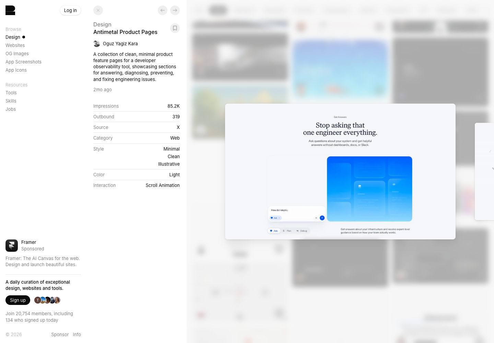

# Antimetal · 技术功能的视觉化表达

[Source](https://recent.design/i/gnxw7rg-antimetal-product-pages) · Inspected 2026-10-12 · Browser viewport 1440×1000.

Evidence: Gallery detail preview only.

## Observed craft

- A centered serif headline contrasts with a softly colored geometric product illustration.
- A single saturated blue region and small white control-like elements anchor the light page.
- The visual illustrates a product capability rather than an arbitrary decorative scene.

## Transfer

For product introductions or empty/onboarding areas, author an image based on the actual capability. A data tool can instead use meaningful native chart geometry.

## Avoid

Marketing illustration is not evidence of working UI. Do not bring its English slogans, extra explanatory lines or simulated results into Chinese operational screens.

## Motion evidence

The gallery tags scroll animation. This study captured one preview and did not verify the original scroll interaction.
