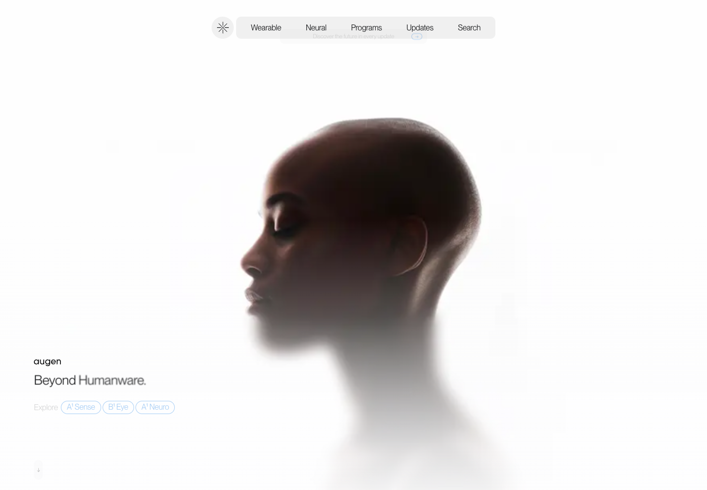
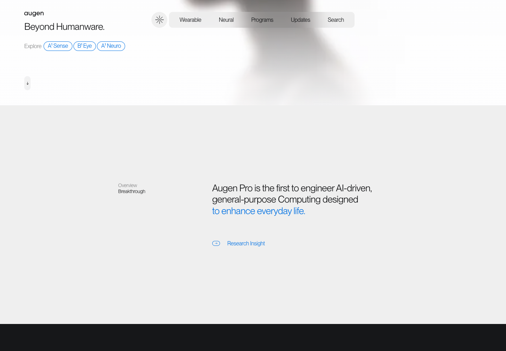

# Augen Pro · 柔光主体与不对称平衡

[Source](https://augen.pro/) · Inspected 2026-10-11 · Browser viewport 1440×1000.

Evidence: Original site initial and scrolled frames.

## Observed craft

- A large softly lit subject emerges into a white field.
- Small left text and a compact floating navigation balance the subject's visual mass.
- The next pale-gray section uses asymmetry and a selective blue accent.

## Transfer

Give art and interface a shared contrast/light system. In a workspace, derive a meaningful focal subject from its data or time domain.

## Avoid

Do not borrow the human-head image for unrelated products. Initial controls were faint during entry; legibility should survive all transition states.

## Motion evidence

Scroll was exercised, but timing curves and pointer behavior were not profiled. Translate the spatial relationship rather than claim identical motion.
