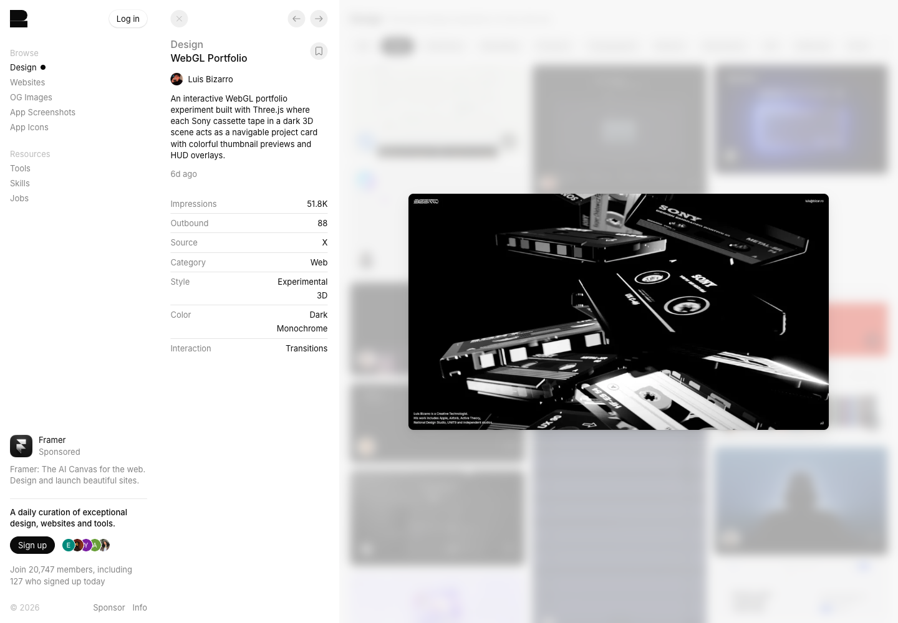

# WebGL Portfolio · 一致光线与空间层次

[Source](https://recent.design/i/68a8v4h-webgl-portfolio-explorer) · Inspected 2026-10-11 · Browser viewport 1440×1000.

Evidence: Gallery detail preview only.

## Observed craft

- Overlapping cassette forms make depth and cropping part of the composition.
- Sharp white edges across black objects share a coherent light treatment.
- Tiny peripheral labels leave the main objects visually dominant.

## Transfer

Translate coherent light and foreground/background relationships into restrained material layers and origin-aware transitions.

## Avoid

A daily financial app does not need arbitrary cassette objects, occlusion of controls or a 3D camera just to look designed.

## Motion evidence

The gallery calls this a WebGL/Three.js experiment. That metadata is not source-code verification; original project navigation was not tested.
