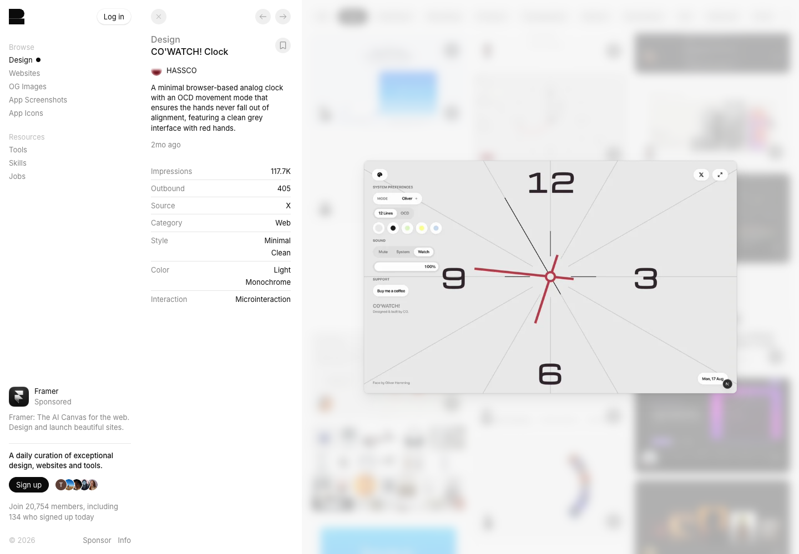

# CO’WATCH! · 精密工具也可以成为视觉作品

[Source](https://recent.design/i/xlkm77w-co-watch-clock-web-app) · Inspected 2026-10-12 · Browser viewport 1440×1000.

Evidence: Gallery detail preview only.

## Observed craft

- A clock face fills the field with a small number of prominent numerals.
- Fine radial guides and red hands give the gray surface a precise focal structure.
- Small controls sit at an edge so the tool itself remains the visual subject.

## Transfer

Let real function supply identity: a time ruler, progress gauge or carefully authored chart can be the signature. Use a controlled accent and consistent stroke weights.

## Avoid

Extra tick marks must have defined meaning; progress arcs must match actual values. Do not inflate static percentages or fake financial motion for visual drama.

## Motion evidence

The gallery describes a movement mode. Only the preview frame was inspected, so clock dynamics and controls remain unverified.
