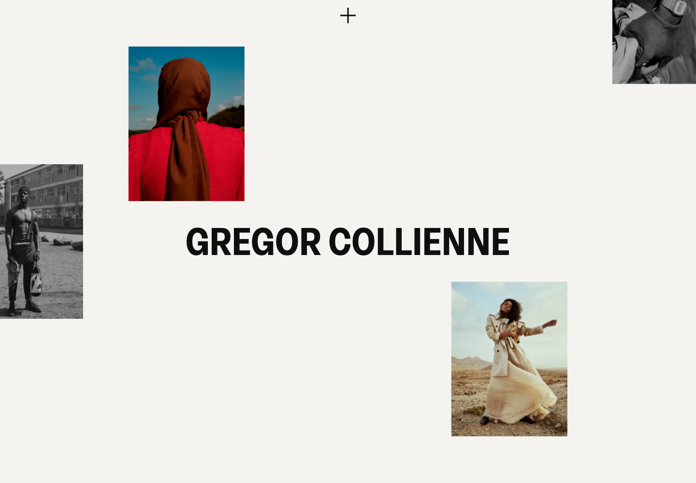
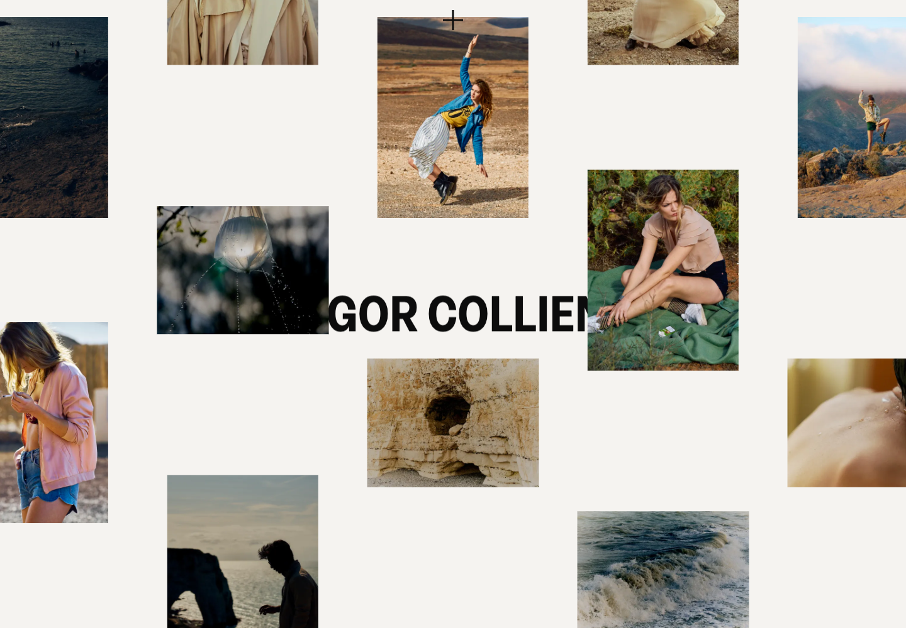

# Gregor Collienne · 图像尺度与视觉节奏

[Source](https://gregorcollienne.com/) · Inspected 2026-10-12 · Browser viewport 1440×1000.

Evidence: Original site initial and scrolled frames; list-mode control could not be exercised.

## Observed craft

- Portrait/landscape crops at different scales balance around a strong central name.
- Off-white space and staggered positions connect photographs without equal card boxes.
- A scrolled frame brings images across the central text, creating a layered collage.

## Transfer

Use unequal scale and considered cropping for portfolios, editorial H5 or visual products. In workspaces, adapt the rhythm to hierarchy rather than scatter data.

## Avoid

Collage overlap must not obscure required controls or financial comparisons. Do not treat unrelated photography as a universal premium ingredient.

## Motion evidence

Scrolled appearance was inspected. The GRID/LIST target was not found in the exercised state; do not claim that toggle or interruption behavior was verified.
