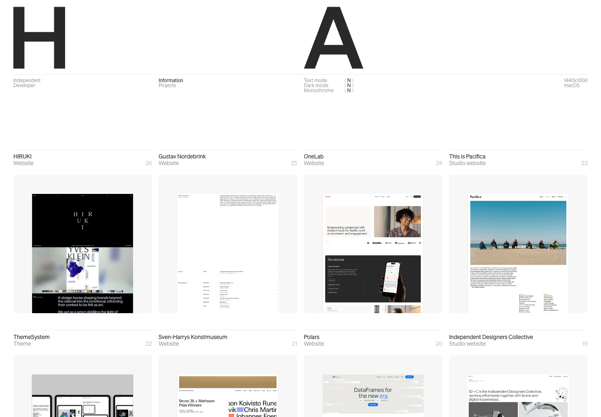
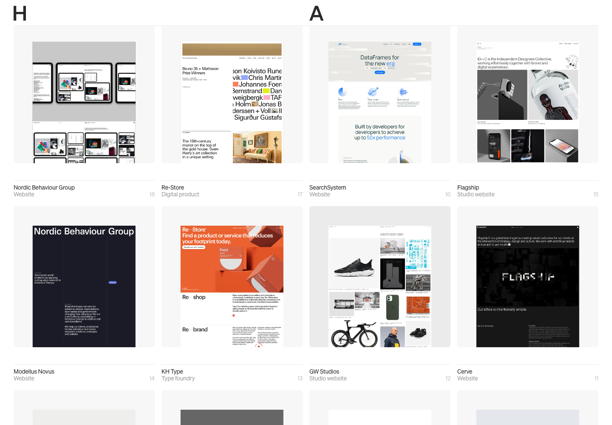

# Harry Atkins · 基线、细线与排版秩序

[Source](https://harryjatkins.com/) · Inspected 2026-10-12 · Browser viewport 1440×1000.

Evidence: Original site initial, pointer-position and scrolled frames.

## Observed craft

- Oversized initials establish a clear header rhythm above a four-column project grid.
- Hairline separators align project names, metadata and images.
- After scrolling, the initials occupy a much smaller header while the projects keep their column rhythm.

## Transfer

Carry the same alignment and spacing grammar from summary to detail. A compact header can preserve orientation while yielding room to useful content.

## Avoid

Do not copy the oversized initials into every application; financial numbers and Chinese text need platform-size calibration. Replace showcase whitespace with task-appropriate breathing room.

## Motion evidence

A scrolled frame shows changed header scale. Exact trigger threshold, continuity and reversibility were not measured.
