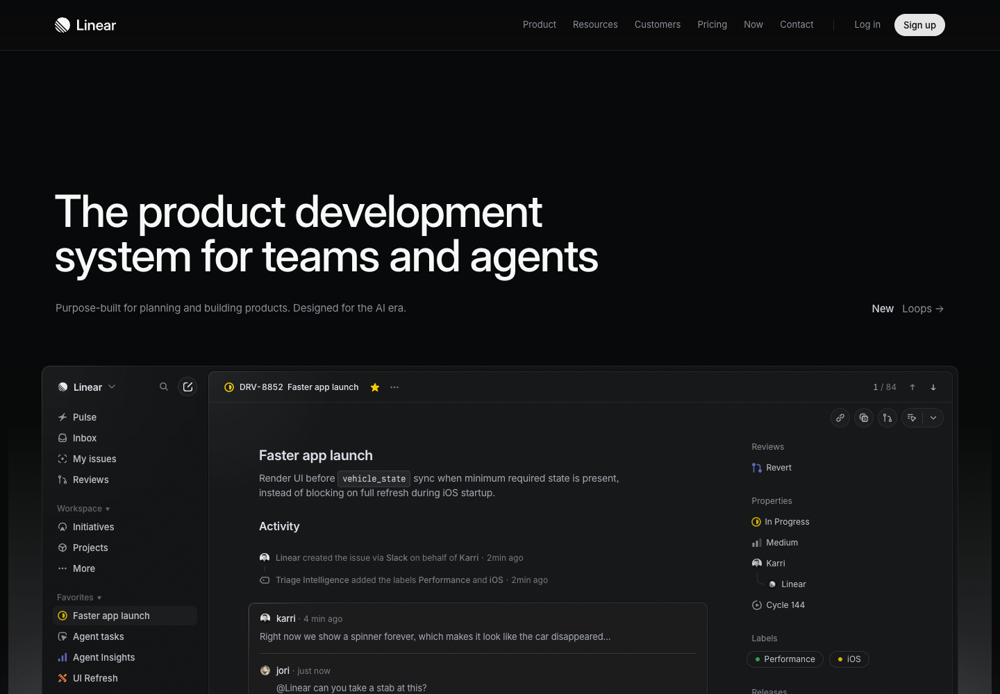

# Linear · 深色界面的精密层级

[Source](https://linear.app/) · Inspected 2026-10-11 · Browser viewport 1440×1000.

Evidence: Original site first rendered frame.

## Observed craft

- Left-aligned type sits above a broad product surface.
- Graphite surfaces, hairlines and restrained secondary contrast organize a dense screen.
- Small accents retain status meaning without turning every component into a highlight.

## Transfer

Use a deliberate tonal ladder and text-weight hierarchy in compact workspaces. Align navigation, content and subpanels as a single system.

## Avoid

Do not treat low contrast as intrinsically premium; labels, focus and charts need practical readability. Do not import issue-tracker content or a marketing headline.

## Motion evidence

No interactive transition was inspected for this capture. The case supports static craft, not measured performance.
