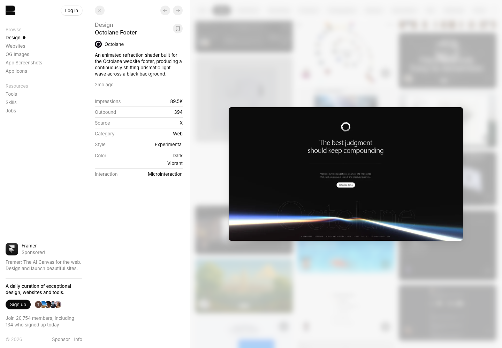

# Octolane · 局部光场与安静的主体

[Source](https://recent.design/i/myd098z-octolane-footer-refraction-shader) · Inspected 2026-10-12 · Browser viewport 1440×1000.

Evidence: Gallery detail preview only.

## Observed craft

- A thin luminous band traverses the lower edge of an otherwise quiet dark composition.
- Brightness is localized, with the upper text/action group remaining sparse.
- Very faint large outline lettering occupies a separate depth level behind the band.

## Transfer

Localize energy to an edge or transition area. Describe light falloff, palette and layer relationships instead of adding broad glow to every panel.

## Avoid

Do not copy decorative giant brand words or place a light wave across real chart lines. Native and mobile versions may need a simpler rendering path.

## Motion evidence

The gallery calls the effect an animated refraction shader. Its original implementation and hands-on response were not inspected.
