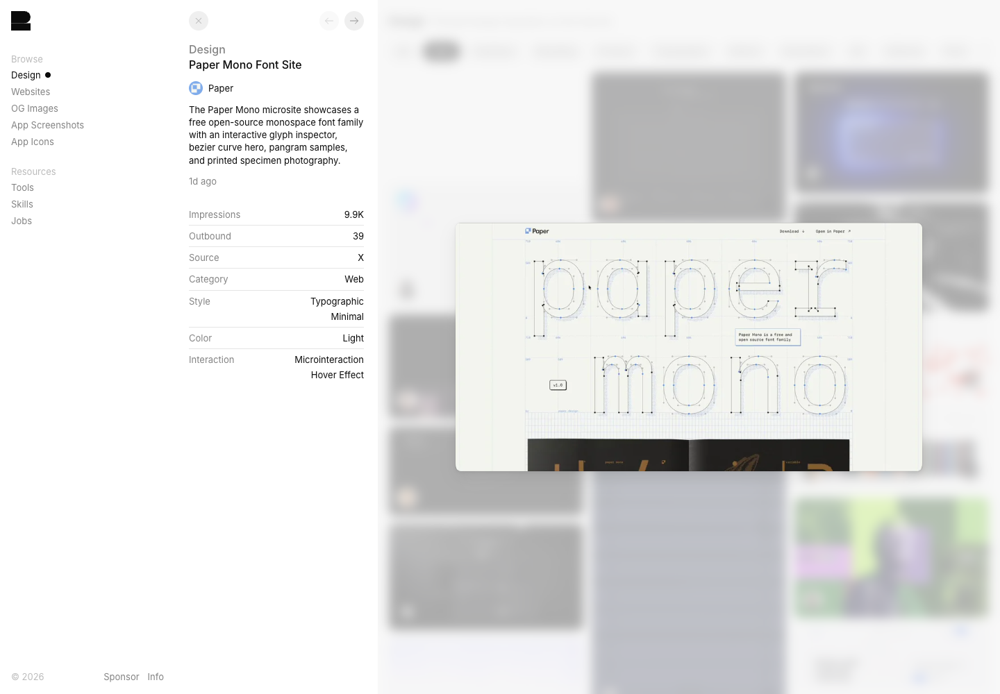

# Paper Mono · 字体成为主视觉

[Source](https://recent.design/i/mi01tni-paper-mono-font-site) · Inspected 2026-10-11 · Browser viewport 1440×1000.

Evidence: Gallery detail preview; original interactions not inspected.

## Observed craft

- Outline letters and visible Bézier handles reveal the subject's construction rather than surround it with stock decoration.
- Very thin grid lines and small annotations stay subordinate to the large letterforms.
- Off-white grounds the technical geometry and leaves the type dominant.

## Transfer

Make the product's own subject expressive: precise curves, temporal graduations or tabular numerals can carry identity in a data tool.

## Avoid

Do not copy huge Latin words or construction labels into a Chinese workspace. Preserve readable chart ticks; decorative grids must not imply false measurement.

## Motion evidence

Gallery describes hover interaction; this capture does not verify it. Prototype any handle/curve response in the actual stack before claiming it works.
