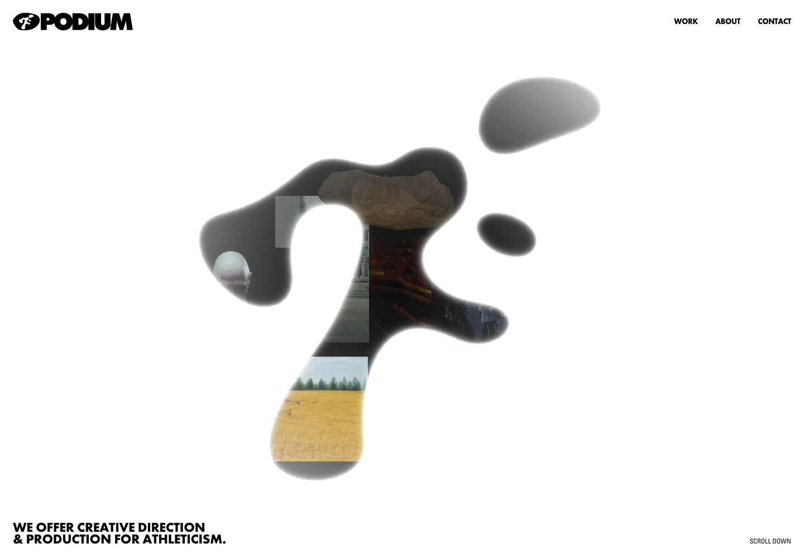
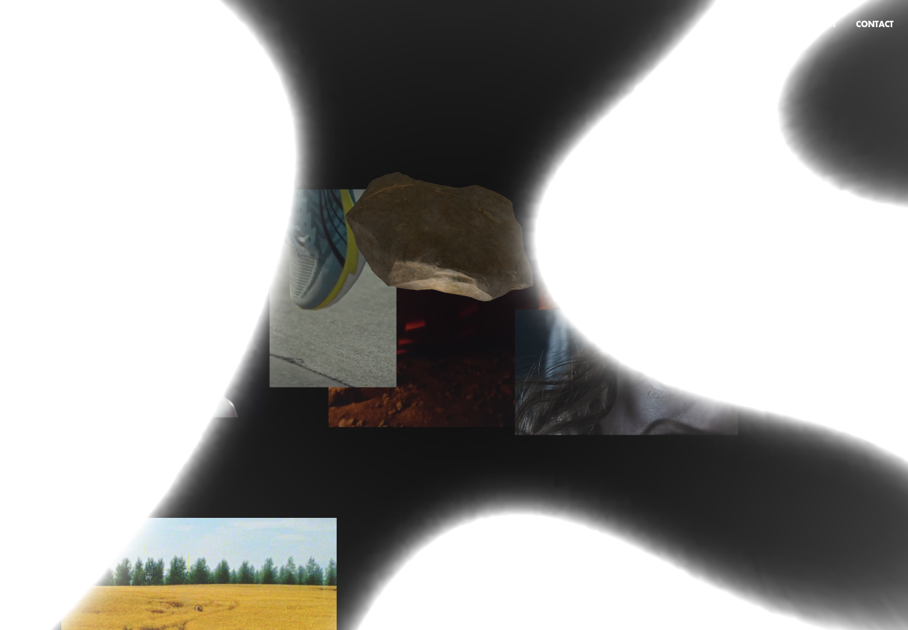

# Podium · 品牌形状成为内容容器

[Source](https://podium.global/) · Inspected 2026-10-12 · Browser viewport 1440×1000.

Evidence: Original site after waiting for load, then scrolled frame; one canvas observed.

## Observed craft

- An organic athlete-like silhouette contains image fragments instead of adding independent decorative cards.
- Black/gray mass on white keeps the shape dominant and the navigation compact.
- A later scrolled frame shows the shape enlarged across the field, with media fragments retained inside.

## Transfer

Use a meaningful brand/domain shape as a single visual system, or translate its continuity into panel/scene handoffs when appropriate.

## Avoid

Do not replace a readable working screen with a mask. This composition suits expressive showcases; tasks need stable control positions and static fallbacks.

## Motion evidence

A load delay and changed scrolled appearance were observed. Exact scroll causality versus ambient evolution, masking method and frame rate were not isolated.
